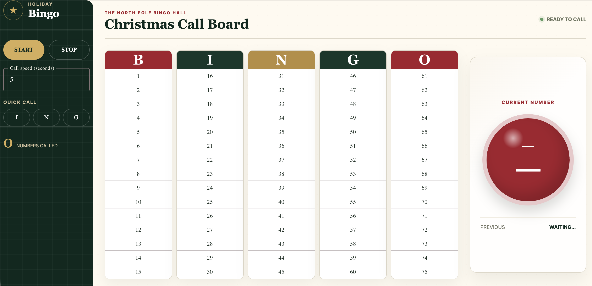
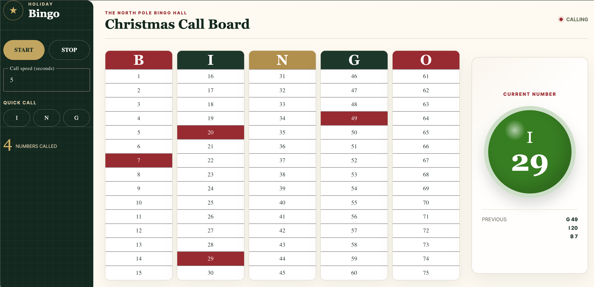
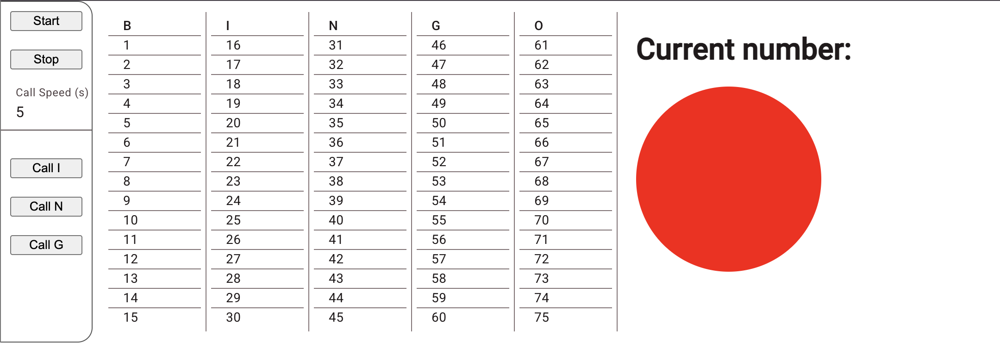
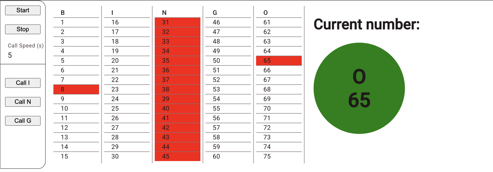

# Christmas Bingo Angular

Simple bingo webapp build for my family to use during our yearly Christmas bingo. Feel free to give it a try on [Github Pages](https://tjoelb.github.io/christmas-bingo-angular/) or build and host it yourself!

## Features

1. Start and stop buttons.
2. Ability to change the calling speed.
3. Ability to call all letters for example call all `N`s when playing large X or four corners.
4. Uses text to speeach (TTS) to call out.

## Development server

To start a local development server, run:

```bash
ng serve
```

Once the server is running, open your browser and navigate to `http://localhost:4200/`. The application will automatically reload whenever you modify any of the source files.

## Before committing

Run the following vs code tasks:

1. `npm: lint`
2. `Check spelling`
3. `npm: build`

## Screenshots

### Angular 22




### Angular 19



